# HRMS Dashboard

A full-stack **Human Resource Management System** dashboard built with the **MERN** stack
(MongoDB, Express, React, Node.js) for the VIGHNOTECH hiring assignment.
HR users can manage candidates, employees, attendance and leaves from one responsive dashboard.

| | |
|---|---|
| **Live demo** | LIVE_URL |
| **Repository** | REPO_URL |
| **Demo login** | `hr@vighnotech.com` / `Hr@12345` |

> The demo account and all demo data are created by the seed script (`npm run seed`, or automatically by `npm run dev:memory`).
> You can also create your own HR account from the **Register** page.
> On Render's free plan the service sleeps when idle, so the first request can take up to about a minute.

---

## Contents

1. [Assignment requirements: where they are implemented](#assignment-requirements-where-they-are-implemented)
2. [Extra features](#extra-features)
3. [Tech stack](#tech-stack)
4. [Architecture](#architecture)
5. [API reference](#api-reference)
6. [Local setup](#local-setup)
7. [Environment variables](#environment-variables)
8. [Testing](#testing)
9. [Deployment](#deployment)
10. [Screenshots](#screenshots)

---

## Assignment requirements: where they are implemented

### 1. Authentication and authorization

| Requirement | Implementation |
|---|---|
| JWT login, HR session valid for **2 hours** | `POST /api/auth/login` signs a JWT with `expiresIn: JWT_EXPIRES_IN` (default and deployed value `2h`) and returns `expiresAt`. The `protect` middleware (`server/src/middlewares/auth.js`) verifies the token on every protected route, and an expired token returns **401 "Session expired, please log in again"**. |
| Form validation on login and registration | **Client:** react-hook-form with zod schemas (`client/src/features/auth/schemas.js`) gives inline errors and a password-strength meter. **Server:** zod (`server/src/validators/auth.validator.js`) enforces a 2-50 character name, a valid unique email, and a password of at least 8 characters with upper case, lower case, a number and a special character, plus confirmation. Server field errors are mapped back onto the form inputs. |
| Auto-logout after the session expires | `client/src/hooks/useAutoLogout.js` sets a timer for `expiresAt - now`. When it fires, the user is logged out, sees a toast, and is redirected to `/login`. An already-expired stored session is discarded when the app loads, and logout is synced across browser tabs (`storage` event). Any 401 from the API also logs the user out (`client/src/services/baseApi.js`). The top bar shows a live session countdown. |

### 2. Candidate management

| Requirement | Implementation |
|---|---|
| CRUD candidate profiles | `/api/candidates` (GET, POST, PATCH, DELETE) plus the **Candidates** page (`client/src/features/candidates`) with a create/edit modal, a details modal, and a delete confirmation. |
| Download resume as PDF | Resumes are uploaded as PDFs (the MIME type and `%PDF` magic bytes are checked, max 5 MB) and stored in MongoDB **GridFS**. `GET /api/candidates/:id/resume` streams the file as an attachment, and the client downloads it with the Bearer token (`client/src/lib/download.js`). |
| Selecting a candidate moves them to employees with details intact | Setting the status to **Selected** (`PATCH /api/candidates/:id/status`, or `PATCH /api/candidates/:id`) creates an Employee with the same name, email, phone, position, department, experience, notes **and resume**, then removes the candidate (`server/src/services/candidate.service.js`). The UI confirms the move and lets HR optionally pick the role (`MoveToEmployeeDialog`), then a toast links to the new employee (`MovedToEmployeesToast`). |
| Optimized search and filters | Server-side pagination, sorting and case-insensitive search (input is regex-escaped) across name, email, phone and position. Filters cover status, department, position and an experience range. Queries use `.lean()` and compound indexes (`{status, department, createdAt}`, `{fullName}`, `{position}`). The client debounces search input (400 ms), keeps filters in the URL, and caches results with RTK Query. |

### 3. Employee management

| Requirement | Implementation |
|---|---|
| Add / update / delete employees | `/api/employees` plus the **Employees** page (form modal and delete dialog). Deleting an employee also deletes their attendance, leaves and files. |
| Assign roles | `PATCH /api/employees/:id/role`, available from the inline role select and the "Assign role" modal. Roles: Intern, Junior, Senior, Team Lead, Manager, Director. |
| Filters and search by name, department, role and other attributes | Search covers name, email, phone and position. Filters cover department, role, position, status and employment type, with sorting and pagination. **Employee details page** (`/employees/:id`): profile, 30-day attendance overview, recent leaves, approved leave days this year, and resume download. |

### 4. Attendance management

| Requirement | Implementation |
|---|---|
| Update tasks and status | The **Attendance** page lists every active employee for a selected date (date navigator, no future dates). HR sets the status inline (Present, Absent, Half Day, Work From Home, On Leave) and edits the day's **task** in a modal. Both save through `PUT /api/attendance`, which upserts by (employee, date) and is protected by a unique index. A per-employee history modal is also available. |
| Filters and search by name, department, role and more | Search covers employee name, email and position. Filters cover department, role, position and status (including **Not Marked**). A summary bar shows counts per status for the date. This is implemented as one MongoDB aggregation (Employee + `$lookup` of that day's attendance). |

### 5. Leave management

| Requirement | Implementation |
|---|---|
| Create a leave and update its status | Leave form modal (employee picker, type, date range, reason, optional document). The status (Pending, Approved, Rejected) can be changed inline. Overlapping non-rejected leaves for the same employee are rejected with **409**. |
| Calendar shows **only approved** leaves, on any date | `GET /api/leaves/calendar?start&end` returns **only `Approved`** leaves. The month calendar marks the days that have approved leaves, and clicking a day lists the approved leaves for that date. Month navigation is supported, and the selected date and month are kept in the URL. |
| **Today** button shows today's approved leaves | The calendar's **Today** button jumps to the current month and selects today, which lists today's approved leaves. The seed data includes several approved leaves that cover today. |
| Documents are downloadable | Optional leave document (PDF, PNG, JPG, DOC or DOCX, max 5 MB) stored in GridFS and downloaded via `GET /api/leaves/:id/document` from the table and the calendar list. |
| Filters and search on leave requests | Search covers employee name, email and position. Filters cover status, leave type, department and a date range (overlap), with sorting and pagination. |

### 6. Design guidelines

| Requirement | Implementation |
|---|---|
| Responsive (desktop, tablet, mobile) | Tailwind CSS mobile-first layouts. The sidebar is fixed on `lg+` and becomes an off-canvas drawer on smaller screens. `DataTable` adapts to the width of its own container: a table when there is room (lower-priority columns appear as space grows and the actions column stays pinned), stacked cards otherwise. Filter bars wrap, modals adapt to small screens, and the calendar uses compact cells with dot indicators on mobile. There is no horizontal page scroll at 360 px. |
| All data dynamic | Every list, count and dropdown comes from the API. Enum options (departments, roles, statuses, leave types) and known positions come from `GET /api/meta/options`, and nothing is hard-coded in feature UIs. The dashboard KPIs come from `GET /api/dashboard/stats`. |
| Time zone (IST) | HR works in India, so "today" is the Indian calendar day on both sides: the server computes it with `Asia/Kolkata` (`server/src/utils/date.js`) and the client shows dates, times and the greeting in IST (`client/src/lib/date.js`). Date-only values (attendance date, leave dates, joining date) are stored as plain calendar days, so they never shift; only real timestamps are converted for display. |

## Extra features

- **Dashboard**: KPI tiles, candidate pipeline, department headcount, today's attendance, people on leave today, pending leaves, and recent candidates and leaves.
- **Live session countdown** in the top bar, plus **multi-tab logout sync**.
- **URL-driven state**: filters, pagination, sorting, attendance date and calendar month are stored in the URL, so views can be bookmarked and shared and the back button works.
- **Employee profile page** with attendance and leave summaries.
- **Attendance history** per employee, and **leave overlap protection**.
- **File storage in GridFS**, so uploads persist on free hosting with an ephemeral disk. File type and size are checked (magic bytes for PDFs).
- **Security**: helmet, a CORS allow-list, rate limiting on login and register (20 requests per 15 minutes per IP), bcrypt password hashing, and validated environment variables.
- **Zero-install dev mode** (`npm run dev:memory`): in-memory MongoDB with seeded demo data.
- **Test suite**: about 120 API tests (Jest + Supertest).
- Accessible UI: labelled controls, keyboard-navigable calendar, focus-managed modals, and skeleton loaders.

## Tech stack

| Layer | Technologies |
|---|---|
| Frontend | React 18, Vite 6, Redux Toolkit + **RTK Query**, React Router 6 (data router), react-hook-form + zod, Tailwind CSS 3, date-fns, lucide-react, react-hot-toast |
| Backend | Node.js 22, Express 4, Mongoose 8, zod, jsonwebtoken, bcryptjs, multer + GridFS, helmet, cors, compression, express-rate-limit, morgan |
| Database | MongoDB (Atlas in production, `mongodb-memory-server` for dev and tests) |
| Testing | Jest + Supertest + mongodb-memory-server (API) |
| Hosting | Render (single web service: API + built client), optional Vercel for the client |

## Architecture

### State management
- **Redux Toolkit store** (`client/src/app/store.js`):
  - `auth` slice: user, token and `expiresAt`, persisted to `localStorage` (`hrms_auth`).
  - `ui` slice: sidebar drawer state.
  - RTK Query `api` slice.
- **RTK Query** (`client/src/services/baseApi.js`): a single `createApi`. Each feature adds its own endpoints with `injectEndpoints` (`candidatesApi`, `employeesApi`, `attendanceApi`, `leavesApi`, `dashboardApi`, `metaApi`, `authApi`). It provides caching, request de-duplication, loading and error states, and **tag-based invalidation**. For example, moving a candidate invalidates `Candidate`, `Employee`, `Dashboard` and `Meta`, so every affected view refreshes automatically.
- **Listener middleware** keeps `localStorage` in sync and handles every logout in one place: it clears storage, shows a toast, and resets the API cache.
- **URL as state** for filters (`useUrlFilters`), and local component state only for UI concerns such as modals (`useDisclosure`).

### Routing
- `createBrowserRouter` (`client/src/app/router.jsx`) with **lazy-loaded pages** and a Suspense fallback, plus a route-level `errorElement` (`RouteErrorBoundary`).
- `PublicOnlyRoute` (`/login`, `/register`) sends signed-in users to the dashboard. `ProtectedRoute` sends guests to `/login` and **returns them to the page they originally requested** after login.
- Routes: `/dashboard`, `/candidates`, `/employees`, `/employees/:id`, `/attendance`, `/leaves`. `/` redirects to `/dashboard`, and `*` shows a 404 page. Page titles are set from route `handle`.
- In production, Express serves `client/dist` and falls back to `index.html` for non-API routes. `client/vercel.json` adds the same rewrite on Vercel.

### Error handling
- **Server:**
  - `asyncHandler` passes async errors to `ApiError` and one central `errorHandler`.
  - The handler maps zod and Mongoose validation errors (400, with field errors), CastError (400), duplicate keys (409), Multer errors (413 or 415), JWT errors (401) and malformed JSON (400).
  - Every error uses one envelope: `{ success:false, message, errors:[{field,message}] }`. Stack traces are not exposed in production.
  - Unknown routes return 404 through `notFound`, and environment variables are validated at startup.
- **Client:**
  - The `baseQuery` wrapper normalizes errors. `lib/errors.js` (`getErrorMessage`, `applyServerErrors`) turns them into readable messages, covering network errors, parsing errors and the server envelope, and maps field errors onto form inputs.
  - Toasts confirm success and report failures. `ErrorState` offers a Retry button, an app-wide `ErrorBoundary` catches render errors, and a route error boundary handles routing errors.

### Reusability
- **UI kit** (`client/src/components/ui`): Button, Input, PasswordInput, Select, Textarea, FileInput, Checkbox, FormField, Modal, ConfirmDialog, DropdownMenu, Badge, StatusBadge, Avatar, Card, StatusSelect, Pagination, SearchInput, Skeleton, Spinner, EmptyState, Alert.
- **Data components**: `DataTable` (container-aware table or card view, sortable columns, loading, empty and error states), `FilterBar`, `FilterSelect`, `EmployeeIdentity` and `getListEmptyState`.
- **Hooks**: `useUrlFilters` (+ `getNextSort`), `useClampPage`, `useElementWidth`, `useDebounce`, `useAutoLogout`, `useCountdown`, `useDisclosure`, `useDownload`, `useMediaQuery`, `useRouteTitle`.
- **Server utilities**: shared query helpers for pagination, sorting, regex search, zero-filled counts and find-or-404 (`utils/query.js`), a `validate()` middleware, a GridFS file service, and response helpers.

### Folder structure

```
HRMS Dashboard/
├── package.json            # root scripts (install, dev, build, start, test)
├── render.yaml             # Render blueprint (one free web service)
├── server/                 # Express + MongoDB REST API
│   ├── src/
│   │   ├── config/         # env.js (validated env), db.js (connection + GridFS), constants.js (enums)
│   │   ├── models/         # User, Candidate, Employee, Attendance, Leave (+ shared file sub-schema)
│   │   ├── validators/     # zod request schemas per resource
│   │   ├── middlewares/    # protect (JWT), validate (zod), upload (multer), errorHandler, notFound
│   │   ├── services/       # business logic: file (GridFS + upload rollback), candidate (move to employee), employee (cascade, summary), attendance (roster), leave (overlap), dashboard (stats)
│   │   ├── controllers/    # thin HTTP handlers
│   │   ├── routes/         # /api router + one router per resource
│   │   ├── utils/          # ApiError, asyncHandler, apiResponse, query, date, token, pdf
│   │   ├── scripts/        # seed.js, dev-memory.js
│   │   ├── app.js          # Express app (exported for tests)
│   │   └── server.js       # DB connect + listen + graceful shutdown
│   ├── tests/              # Jest + Supertest API tests
│   └── .env.example
└── client/                 # React + Vite SPA
    ├── src/
    │   ├── app/            # store.js, router.jsx, uiSlice.js
    │   ├── services/       # baseApi.js (RTK Query base + auth/401 handling)
    │   ├── features/       # feature modules: api slice, pages/, components/, hooks/, utils/, constants.js, schemas.js
    │   │   └── auth/ dashboard/ candidates/ employees/ attendance/ leaves/ meta/
    │   ├── components/
    │   │   ├── ui/         # reusable UI kit
    │   │   ├── data/       # DataTable, FilterBar, FilterSelect, EmployeeIdentity, listEmptyState
    │   │   ├── layout/     # AppLayout, Sidebar, Topbar, PageHeader, AuthLayout, SessionTimer
    │   │   ├── routing/    # ProtectedRoute, PublicOnlyRoute, RouteErrorBoundary
    │   │   └── feedback/   # ErrorBoundary, ErrorState, PageLoader
    │   ├── hooks/          # reusable hooks
    │   ├── lib/            # framework-free helpers: download, date, format, query, errors, formData, validation, constants, cn
    │   └── pages/          # NotFoundPage
    ├── vercel.json
    └── .env.example
```

## API reference

Base path `/api`. Every route except `health`, `auth/register` and `auth/login` requires `Authorization: Bearer <token>`.

- **Success responses:** `{ success: true, message?, data, meta? }`. `meta` (`page`, `limit`, `total`, `totalPages`) is included on paginated lists.
- **Error responses:** `{ success: false, message, errors?: [{ field, message }] }`.
- **List query parameters:** `page`, `limit` (max 100), `search`, `sortBy` and `sortOrder` (`asc` or `desc`).
- **Dates:** sent as `YYYY-MM-DD`.

| Method | Endpoint | Description |
|---|---|---|
| GET | `/health` | Health check (public) |
| POST | `/auth/register` | Register an HR user, returns `{ user, token, expiresAt }` |
| POST | `/auth/login` | Log in, returns `{ user, token, expiresAt }` (2-hour JWT) |
| GET | `/auth/me` | Current user + `expiresAt` |
| POST | `/auth/logout` | Log out (stateless) |
| GET | `/meta/options` | Dropdown options (departments, roles, statuses, leave types, positions) |
| GET | `/dashboard/stats?date=` | Dashboard KPIs for a date |
| GET | `/candidates` | List candidates; filters: `status`, `department`, `position`, `minExperience`, `maxExperience` |
| POST | `/candidates` | Create a candidate (**multipart**, `resume` PDF required) |
| GET | `/candidates/:id` | Get a candidate |
| PATCH | `/candidates/:id` | Update a candidate (**multipart**, optional new `resume`); `status=Selected` moves them to employees |
| PATCH | `/candidates/:id/status` | Change status; `Selected` moves them to employees (optional `role`) |
| DELETE | `/candidates/:id` | Delete a candidate (and their resume) |
| GET | `/candidates/:id/resume` | Download the resume PDF |
| GET | `/employees` | List employees; filters: `department`, `role`, `position`, `status`, `employmentType` |
| POST | `/employees` | Create an employee |
| GET | `/employees/:id` | Get an employee |
| PATCH | `/employees/:id` | Update an employee |
| PATCH | `/employees/:id/role` | Assign a role |
| DELETE | `/employees/:id` | Delete an employee (cascades to attendance, leaves and files) |
| GET | `/employees/:id/resume` | Download the resume (for employees moved from candidates) |
| GET | `/employees/:id/summary` | Profile + 30-day attendance + leave summary |
| GET | `/attendance?date=` | Active employees with that day's attendance; filters: `department`, `role`, `position`, `status` (incl. `Not Marked`); `meta.summary` |
| PUT | `/attendance` | Upsert `{ employeeId, date, status, task }` |
| PATCH | `/attendance/:id` | Update status/task |
| DELETE | `/attendance/:id` | Delete a record |
| GET | `/attendance/employee/:employeeId?from=&to=` | An employee's attendance history |
| GET | `/leaves` | List leaves; filters: `status`, `leaveType`, `department`, `employeeId`, `from`, `to` |
| GET | `/leaves/calendar?start=&end=` | **Approved** leaves overlapping a date range |
| POST | `/leaves` | Create a leave (**multipart**, optional `document`) |
| GET | `/leaves/:id` | Get a leave |
| PATCH | `/leaves/:id` | Update a leave (**multipart**, optional new `document`) |
| PATCH | `/leaves/:id/status` | Approve, reject or reset to pending |
| DELETE | `/leaves/:id` | Delete a leave (and its document) |
| GET | `/leaves/:id/document` | Download the leave document |

## Local setup

Prerequisites: **Node.js 20 or later** (22 recommended) and npm.

```bash
git clone REPO_URL
cd "HRMS Dashboard"
npm run install:all          # installs the server/ and client/ dependencies
```

### Option A: zero setup (no MongoDB install needed)

```bash
npm run dev:memory           # terminal 1: API on :5000 with an in-memory MongoDB + seeded demo data
npm run dev:client           # terminal 2: Vite on http://localhost:5173 (proxies /api to :5000)
```

Open http://localhost:5173 and log in with `hr@vighnotech.com` / `Hr@12345`.
Data lives only while `dev:memory` is running, and every restart starts again from fresh seed data.
The first run downloads a MongoDB binary, which is cached afterwards.

### Option B: your own MongoDB (local or Atlas)

```bash
cp server/.env.example server/.env    # then set MONGODB_URI (and JWT_SECRET)
npm run seed                          # WIPES the target database and loads the demo data
npm run dev:server                    # terminal 1: API with nodemon on :5000
npm run dev:client                    # terminal 2: client on :5173
```

### Production build locally

```bash
npm run build:client
# then start the API with NODE_ENV=production; it serves client/dist on the same origin, e.g. (bash):
NODE_ENV=production JWT_SECRET=<min-16-chars> MONGODB_URI=<uri> npm start
```

### Root scripts

| Script | Description |
|---|---|
| `npm run install:all` | Install the server and client dependencies |
| `npm run dev:memory` | API with an in-memory MongoDB + demo data |
| `npm run dev:server` / `npm run dev:client` | API (nodemon) / Vite dev server |
| `npm run seed` | Reset the database at `MONGODB_URI` and load demo data (refuses in production unless `--force`) |
| `npm run build:client` | Build the client into `client/dist` |
| `npm run build` | **CI/Render build**: clean install (server without dev dependencies, client with them) + client build |
| `npm start` | Start the API (serves the client too when `NODE_ENV=production`) |
| `npm run lint` | ESLint for the client |
| `npm test` | Server API tests |

> `npm run build` is meant for the deployment environment. It runs `npm ci --omit=dev` in `server/`, which removes the local test and dev tools. Run `npm run install:all` afterwards if you used it locally.

## Environment variables

**Server** (`server/.env`, see `server/.env.example`)

| Variable | Default | Description |
|---|---|---|
| `NODE_ENV` | `development` | `development`, `production` or `test` |
| `PORT` | `5000` | HTTP port (Render injects it) |
| `MONGODB_URI` | `mongodb://127.0.0.1:27017/hrms` | MongoDB connection string |
| `JWT_SECRET` | dev-only fallback | JWT signing secret, **required in production** (min 16 characters) |
| `JWT_EXPIRES_IN` | `2h` | HR session lifetime (the assignment requires 2 hours) |
| `CLIENT_URL` | `http://localhost:5173` | CORS allow-list, comma-separated (for example, the Vercel URL) |
| `KEEP_ALIVE_URL` | none | Public URL of the service. Production only; on Render `RENDER_EXTERNAL_URL` is used automatically, so leave this empty there |
| `KEEP_ALIVE_INTERVAL_MINUTES` | `10` | Minutes between keep-alive pings (1 to 14) |

**Client** (`client/.env`, see `client/.env.example`)

| Variable | Default | Description |
|---|---|---|
| `VITE_API_URL` | `/api` | API base URL. Set it only when the client is hosted separately, e.g. `https://<render-app>.onrender.com/api` |

## Testing

**API tests** (Jest + Supertest + mongodb-memory-server, so no database setup is needed):

```bash
npm test
```

They cover authentication (2-hour expiry, expired and invalid tokens, validation), candidate CRUD, resume upload and download, the move-to-employee flow, employees and roles, attendance upserts and filters, leaves (overlap, status, calendar returning only approved leaves, documents), and the error envelope and 404s.


## Deployment

### 1. MongoDB Atlas (free M0 cluster)
1. Create a free cluster at https://cloud.mongodb.com.
2. Under **Database Access**, create a database user. Under **Network Access**, allow `0.0.0.0/0` (Render free instances have no static IP).
3. Copy the connection string and add a database name, e.g. `mongodb+srv://<user>:<pass>@<cluster>.mongodb.net/hrms?retryWrites=true&w=majority`.
4. Load the demo data from your machine:
   ```bash
   # bash; NODE_ENV must not be "production" here (seeding wipes the target DB)
   MONGODB_URI="mongodb+srv://..." npm run seed
   ```

### 2. Render (API and client as one free web service)
The repository includes a blueprint, `render.yaml`. It builds with `npm run build`, starts with `npm start`, and health-checks `/api/health`.
1. Push the repository to GitHub. In Render, choose **New, then Blueprint**, and select the repository.
2. Fill in the prompted secrets:
   - `MONGODB_URI`: the Atlas connection string.
   - `CLIENT_URL`: the service's own URL, e.g. `https://hrms-dashboard.onrender.com`. Add a Vercel URL with a comma if you also use Vercel.
3. Render generates `JWT_SECRET` automatically. `NODE_ENV=production` and `JWT_EXPIRES_IN=2h` are preset.
4. After the deploy, open the service URL. Express serves the React build and the API from the same origin, so `VITE_API_URL` is not needed.
5. **Keep-alive.** Render's free plan puts a service to sleep after about 15 minutes without traffic, and the next visit then waits 30 to 60 seconds. In production the server therefore pings its own public `/api/health` every 10 minutes (`server/src/services/keepAlive.service.js`, started from `server.js`). It needs no configuration on Render, and it does nothing locally or in tests. It can only keep an awake service awake: it cannot wake one that is already asleep, so for extra safety also add a free external monitor (for example UptimeRobot) that requests `/api/health` every 5 minutes.

### 3. Optional: frontend on Vercel
1. Import the repository in Vercel and set **Root Directory** to `client`. `client/vercel.json` already sets up the Vite build and the SPA rewrite.
2. Add the environment variable `VITE_API_URL=https://<your-render-service>.onrender.com/api` and deploy.
3. On Render, add the Vercel URL to `CLIENT_URL` (comma-separated) so CORS allows it, then redeploy or restart.

## Screenshots

| View | Desktop | Mobile |
|---|---|---|
| Login | 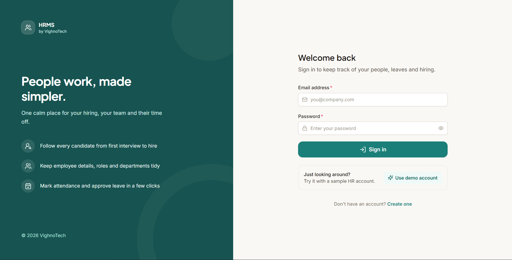 | 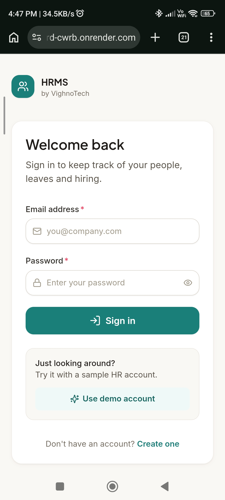 |
| Dashboard | 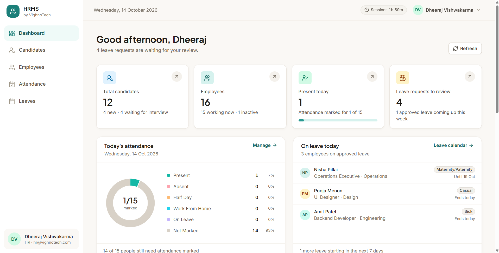 | 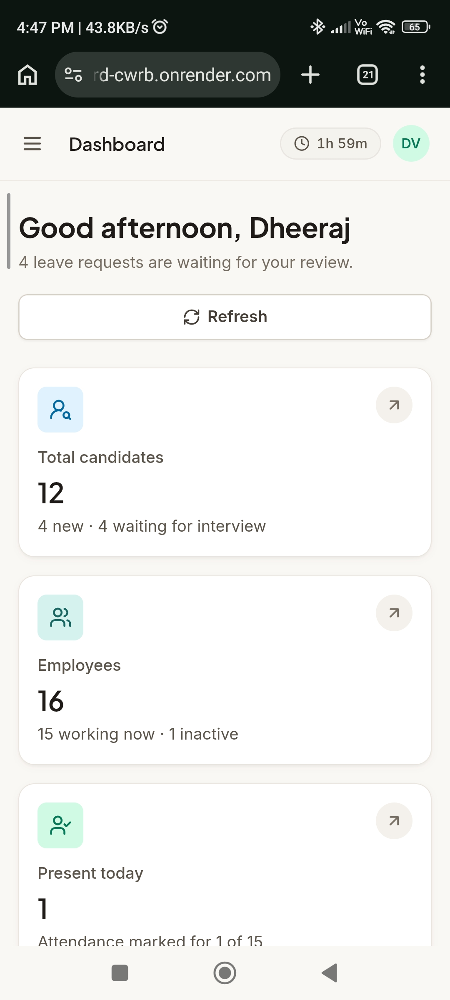 |
| Candidates | 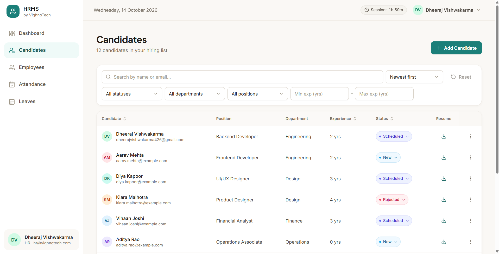 | 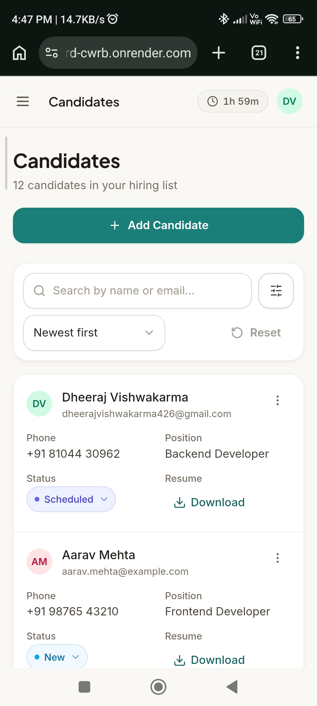 |
| Employees | 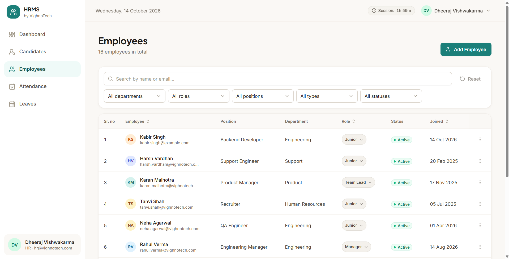 | 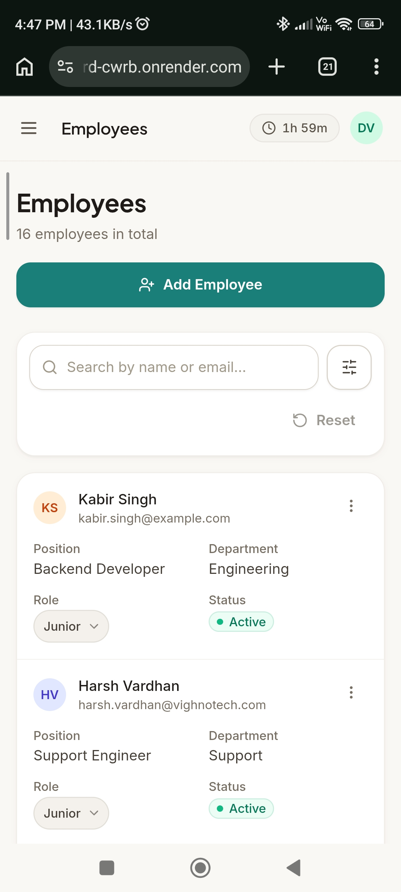 |
| Attendance | 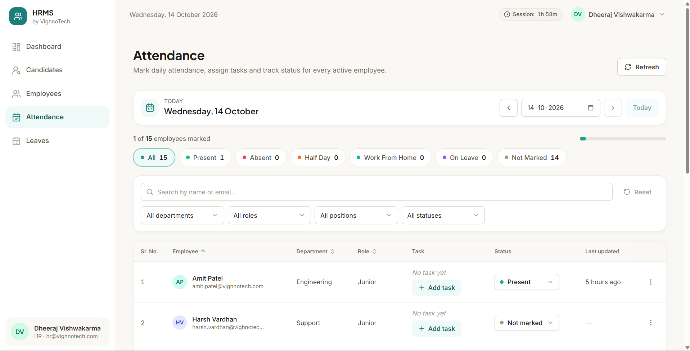 | 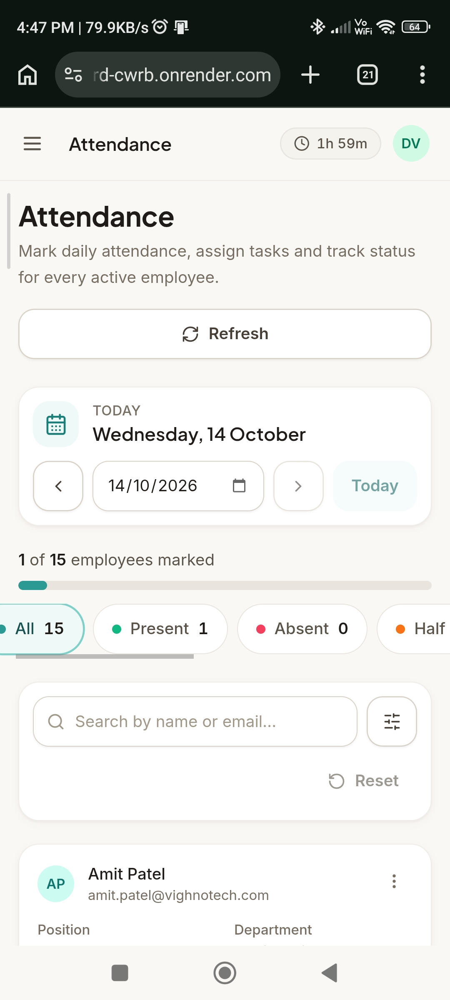 |
| Leaves + calendar | 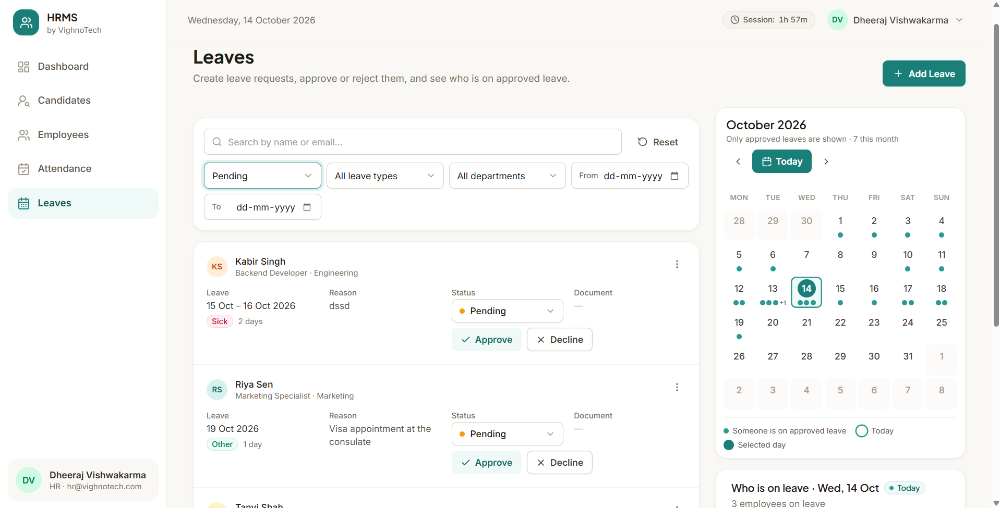 | 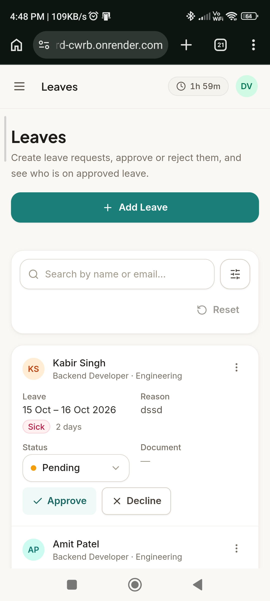 |

---

Built for the VIGHNOTECH MERN developer assignment.
